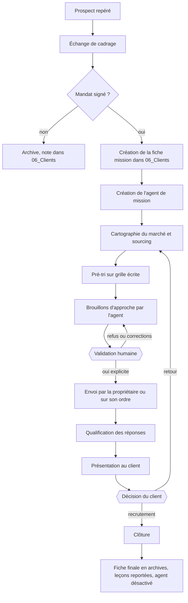

# Le flux d'une mission

Du premier contact avec un client à la clôture, avec l'endroit où l'humain décide.

## Les trois points de contrôle humains

1. **Avant tout envoi** : le texte d'approche est relu et validé, pour cet envoi précis.
2. **Avant toute présentation** : les profils présentés sont choisis par la propriétaire, pas par l'agent.
3. **À la clôture** : la propriétaire décide ce qui part en archives et ce qui devient une règle commune.

## Ce que l'agent fait seul

Cartographier, pré-trier sur la grille écrite, tenir la fiche à jour, rédiger les brouillons, signaler ce qui stagne. Il ne contacte personne et ne décide de rien qui engage la propriétaire.

## Ce qui reste hors du flux

Les sujets sensibles vivent dans un espace étanche, sans passerelle avec les agents de mission.
